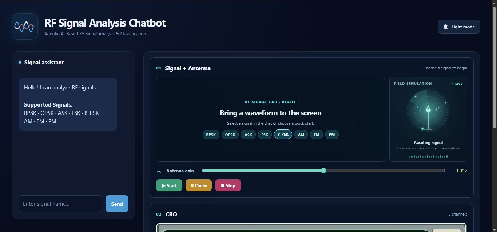
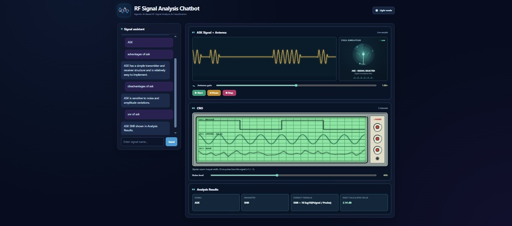
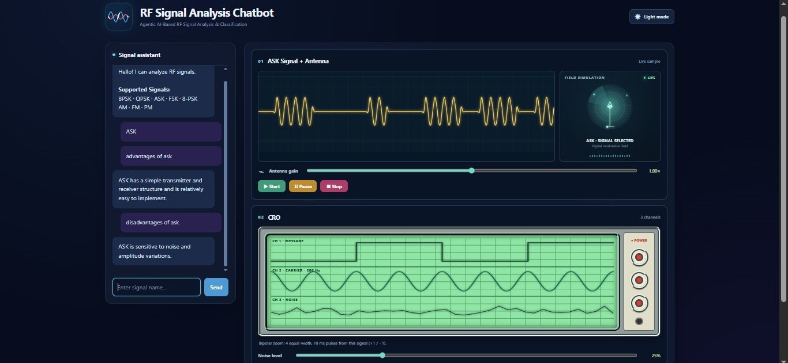
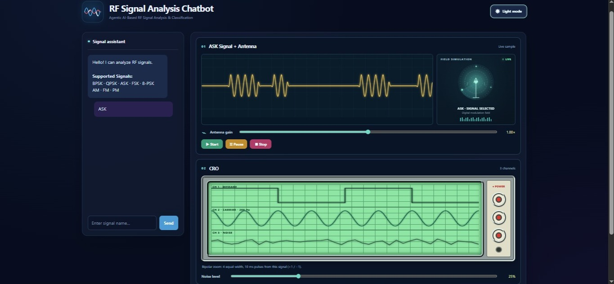

# Agentic AI-Based RF Signal Analysis and Classification

## Project Gallery

---

## Project Overview

An Agentic AI-based RF Signal Analysis system designed to simulate, analyse and classify different radio frequency signals using Python and signal-processing techniques.

The project explores how signal processing and AI concepts can support RF signal analysis and parameter estimation.

## Key Features

- RF signal simulation
- Modulation classification
- FFT-based frequency analysis
- Signal parameter estimation
- Interactive visualisation
- Agentic AI-based analysis workflow

## Modulation Types Covered

- BPSK
- QPSK
- ASK
- FSK
- 8PSK
- AM
- FM
- PM

## Signal Parameters Explored

- Carrier Frequency
- Bandwidth
- Amplitude
- RMS Value
- Signal Power
- Signal-to-Noise Ratio (SNR)
- Phase
- Sampling Frequency
- Peak Frequency

## Technologies and Tools

- Python
- NumPy
- SciPy
- Scikit-learn
- Streamlit
- LangGraph
- Agentic AI Concepts

## Learning Outcomes

- Fundamentals of RF signal processing
- Digital and analog modulation concepts
- FFT and frequency-domain analysis
- Signal parameter estimation
- Python-based technical computing
- Exploring AI-assisted signal analysis workflows

## Project Details

| Category | Details |
|---|---|
| Domain | RF and Signal Processing |
| Programming Language | Python |
| Project Type | Academic Team Project |
| Focus | Signal Analysis and Classification |
| AI Approach | Agentic AI Concepts |

---

**Note:** This repository contains project documentation, images and the available project archive. Individual source files are not currently provided.
